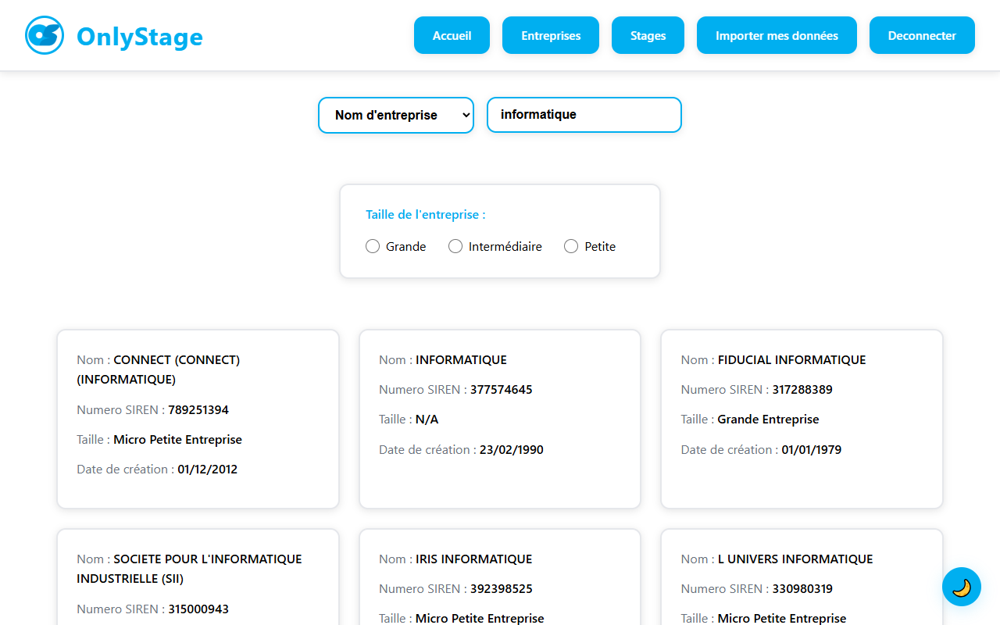
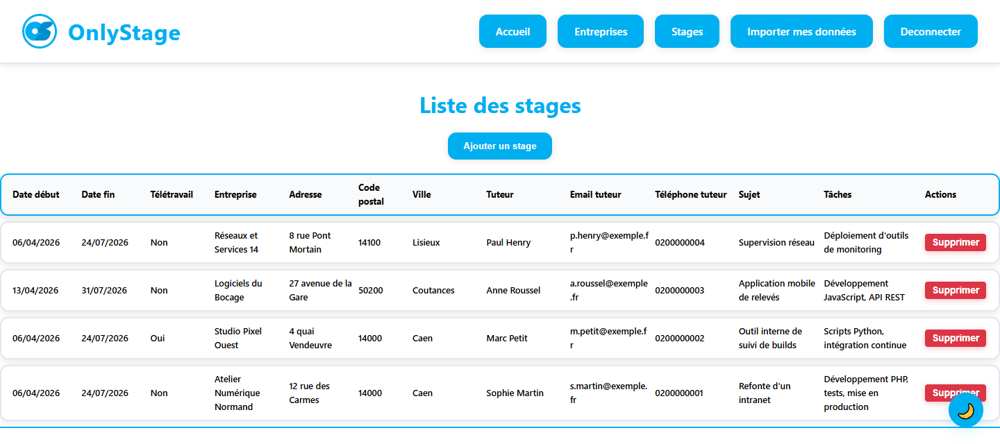
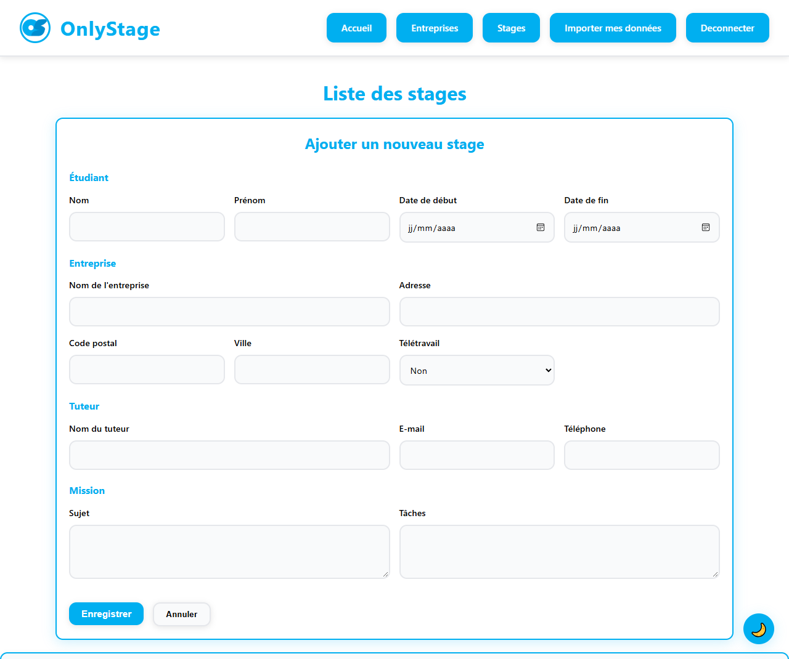

# OnlyStages

Un outil de recherche d'entreprises et de gestion de stages pour étudiants, développé en PHP, HTML, CSS et JavaScript. Trouvez vos stages et entreprises facilement !

## 📸 Aperçu

Recherche d'entreprises par l'API de l'annuaire des entreprises :



Liste des stages, vue par un administrateur :



<details>
<summary>Formulaire d'ajout d'un stage</summary>



</details>

Les données affichées sont fictives.

## ✨ Fonctionnalités

- 🔍 Recherche d'entreprises via API gouvernementale française
- 📋 Gestion des stages (ajout, modification, suppression pour admins)
- 👤 Système d'authentification (étudiants, enseignants, admins)
- 📄 Importation de données CSV pour admins
- 📱 Interface responsive
- 🎨 Design moderne

## 🛠️ Installation et Configuration

### Prérequis

- **XAMPP** (ou un serveur local avec Apache, MySQL, PHP)
- **Navigateur web** moderne

### Étapes d'installation

1. **Clonez le repository** : `git clone <url-du-repo>`

2. **Installez et démarrez XAMPP** :
   - Téléchargez XAMPP depuis https://www.apachefriends.org/
   - Installez-le et lancez le panneau de contrôle
   - Démarrez les modules **Apache** et **MySQL**

3. **Accédez à phpMyAdmin** :
   - Ouvrez votre navigateur et allez sur `http://localhost/phpmyadmin/`

4. **Créez la base de données** :
   - Cliquez sur "Bases de données" dans le menu de gauche
   - Dans "Créer une base de données", entrez `onlystages_bd`
   - Cliquez sur "Créer"

5. **Importez le fichier SQL** :
   - Sélectionnez `onlystages_bd` dans le menu de gauche
   - Cliquez sur l'onglet "Importer"
   - Choisissez le fichier `onlystages_bd.sql` situé à la racine du projet
   - Cliquez sur "Exécuter" (cochez "Supprimer les tables existantes" si nécessaire)

6. **Placez le projet dans XAMPP** :
   - Copiez le dossier du projet dans `C:\xampp\htdocs\`
   - Renommez-le si nécessaire (ex: `onlystage`)

7. **Vérifiez la configuration** :
   - Les tables suivantes devraient être créées : `ONL_COMPTE`, `ONL_ENTREPRISE`, `ONL_LISTESTAGE`, `ONL_STAGE`, `ONL_TYPE_COMPTE`
   - Des comptes de test sont inclus (admin, enseignant, étudiant)

---

### ⚠️ Important

- La base utilise l'utilisateur MySQL par défaut `root` sans mot de passe (configuration XAMPP standard)
- Si vous utilisez un autre serveur, copiez `app/core/config.local.example.php` en `app/core/config.local.php` et mettez-y vos identifiants
- Ne partagez pas vos identifiants de base de données publiquement

---

### ✅ Comptes de test inclus (démo locale uniquement)

- **Administrateur** : email `ADMIN@ADMIN`, mot de passe `ADMIN`
- **Enseignant** : email `ENS@ENS`, mot de passe `ENS`
- **Étudiant** : email `jean.dupont@etu.unicaen.fr`, mot de passe `etudiant`

## 🎮 Comment Utiliser

1. Ouvrez `http://localhost/OnlyStages/` dans votre navigateur (adaptez le nom du dossier)
2. Connectez-vous avec un compte de test
3. Explorez :
   - **Entreprises** : Recherchez des entreprises françaises par nom, activité, département
   - **Stages** : Consultez les stages disponibles (admins peuvent en ajouter)
   - **Importer** : Admins peuvent importer des données CSV

## 📂 Structure du Projet

```
OnlyStages/
├── index.php              # Point d'entrée principal
├── app/
│   ├── core/              # Logique backend (config, contrôleurs)
│   └── views/             # Templates HTML/PHP
├── public/
│   ├── css/               # Styles CSS
│   ├── img/               # Images
│   └── script/            # JavaScript
├── onlystages_bd.sql      # Dump de la base de données
└── README.md              # Ce fichier
```

## 🛠️ Technologies

- **PHP** : Backend et logique serveur
- **MySQL** : Base de données
- **HTML5/CSS3** : Interface utilisateur
- **JavaScript** : Interactions dynamiques
- **PDO** : Connexion à la base de données

### 👥 Équipe

Ce projet a été réalisé dans le cadre d’un travail de groupe réunissant :


- **ESNAULT Clément**
- **KAHLOUCHE Mohamed**
- **MONTALS Lylian**
- **PELLETIER Antoine**
- **SOREL Milo**

**Projet réalisé dans le cadre d'un cours de développement web.**

### 🙋 Mon rôle

Ce dépôt est mon fork personnel du projet. J'ai travaillé sur la partie PHP avec Mohamed et je me suis occupé de toute la partie import :

- l'import CSV des stages par un administrateur : lecture du fichier, conversion des dates, insertion en une seule transaction
- l'import des entreprises dans la base

Depuis le rendu, ce fork a aussi reçu des correctifs de sécurité : mots de passe hachés à l'inscription, imports réservés aux administrateurs et jetons CSRF sur les formulaires.
